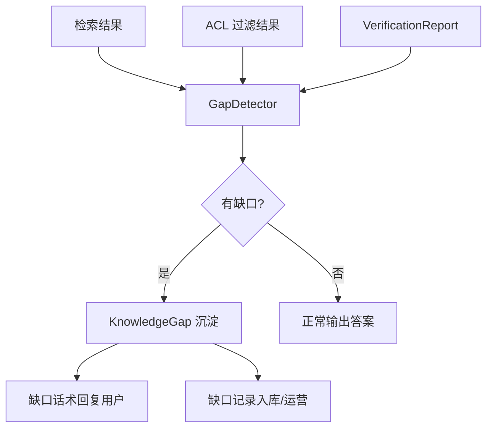

# Chapter 11 · Knowledge Gap 知识缺口治理

> 前面 Ch08 的「ACL 过滤后不足」、Ch09 的「无合法引用」、Ch10 的「验证 UNSUPPORTED」，都指向同一个出口：**转 Knowledge Gap**。本章把这个反复出现的兜底动作，升级为一等公民——教 Agent 优雅地承认「我不知道」，并把每一次「不知道」沉淀为可运营的资产。

---

## 一、为什么学（Why）

### 1.1 硬答比不答更危险

一个企业知识 Agent 最贵的不是「没答上」，而是「不懂装懂」。看两种失败：

- **A 类失败（沉默）**：用户问「2026 年的差旅报销标准」，知识库里没有，Agent 回「抱歉，暂无相关资料」。用户失望，但不会被误导。
- **B 类失败（幻觉）**：同样的问题，Agent 硬凑出一个「每天 500 元」的编造答案。用户信了，报销被驳回，最后追责到系统头上。

**A 类可控，B 类致命。** 前十章我们层层设卡（ACL、Citation、Verification），本质都是在把 B 类失败挡回来。但挡回来之后总要有个**统一的出口**——这就是 Knowledge Gap（知识缺口）。

### 1.2 缺口不只是「兜底」，更是「金矿」

每一次「我不知道」，都在告诉你两件事：

1. **用户真实需要什么**：缺口即需求。高频缺口 = 最该补的文档。
2. **知识库的边界在哪**：缺口分布 = 知识库健康度地图。

如果只是简单回一句「查无资料」就丢弃，等于把用户的真实需求信号白白扔掉。**成熟的系统会把缺口结构化沉淀下来**，反哺到内容运营、文档补全、甚至产品迭代。这就是「知识缺口治理」——从被动兜底，到主动运营。

### 1.3 本章要解决的三个命题

1. **怎么判定缺口**：哪些信号意味着「这题答不了」？如何统一收口？
2. **缺口怎么分类**：不同成因的缺口，处置策略截然不同。
3. **缺口怎么沉淀**：一次「不知道」，如何变成可追踪、可运营的记录？

---

## 二、是什么（What）

### 2.1 核心概念：什么是知识缺口

> **知识缺口（Knowledge Gap）**：当 Agent 无法用「检索到的、有权访问的、经过验证的」证据回答用户问题时，所处的状态。

注意这个定义里的三个限定词，恰好对应前三章的三道闸门：

| 限定词 | 对应闸门 | 缺口信号 |
| --- | --- | --- |
| 检索到的 | Ch05 检索 / Ch06 融合 | 检索结果为空 / 最高分低于阈值 |
| 有权访问的 | Ch08 ACL | 过滤后可见片段不足 |
| 经过验证的 | Ch10 Verification | 验证结论为 UNSUPPORTED |

**关键洞察**：缺口不是链路中某一环的私有逻辑，而是整条链路的**统一失败出口**。任何一环判定「无法继续」，都收敛到同一个 `KnowledgeGap`。

### 2.2 缺口的四种成因分类

不分类的缺口是没法运营的。按成因划分，处置策略完全不同：

| 类型 | 成因 | 典型信号 | 处置方向 |
| --- | --- | --- | --- |
| **NO_MATCH（无匹配）** | 知识库压根没这内容 | 检索为空 / 全部低分 | 补文档、建内容 |
| **LOW_CONFIDENCE（低置信）** | 有沾边内容但不够强 | 最高分低于阈值 | 优化切片 / 提示改写问法 |
| **ACCESS_RESTRICTED（权限受限）** | 内容存在但用户无权 | ACL 过滤后不足 | 走审批 / 提示申请权限 |
| **UNVERIFIED（验证不过）** | 检索到了但答案接不住 | 验证 UNSUPPORTED | 人工复核 / 二次检索 |

**为什么要区分？** 因为对用户的话术、对运营的动作都不一样：`NO_MATCH` 提示「暂无资料，已记录您的需求」；`ACCESS_RESTRICTED` 提示「相关内容需申请权限」；两者混为一谈会让用户困惑，也让运营抓不住重点。

### 2.3 缺口判定的收口点：GapDetector

我们用一个统一的端口 `GapDetector`，把散落在各环节的判定逻辑收拢：



**设计原则**：检测与处置分离。`GapDetector` 只负责「判定 + 产出结构化缺口」，至于「怎么回复用户」「怎么入库」交给上层——保证单一职责，也方便替换存储与话术策略。

---

## 三、怎么用（How）

> 所有代码位于包 `com.zero.ai.agentstudy.day16knowledgeagentv2.gap`，复用 Ch05 `RetrievedChunk`、Ch10 `VerificationReport`、core 的 `AgentContext` / `AgentErrorCode`，可独立编译。

### 3.1 缺口类型枚举：GapType

```java
package com.zero.ai.agentstudy.day16knowledgeagentv2.gap;

/**
 * 知识缺口的成因分类。不同类型对应不同的用户话术与运营动作。
 */
public enum GapType {

    /** 知识库无匹配内容：检索为空或全部低分。 */
    NO_MATCH("暂无相关资料，已记录您的需求"),

    /** 有沾边内容但置信度不足：最高分低于阈值。 */
    LOW_CONFIDENCE("找到部分相关内容，但不足以给出可靠回答"),

    /** 内容存在但当前用户无权访问。 */
    ACCESS_RESTRICTED("相关内容存在，但您暂无访问权限，可申请授权"),

    /** 检索到内容但答案无法被证据支持（验证不通过）。 */
    UNVERIFIED("暂时无法给出经过核实的回答，已转人工复核");

    private final String userHint;

    GapType(String userHint) {
        this.userHint = userHint;
    }

    /** 面向用户的友好话术。 */
    public String userHint() {
        return userHint;
    }
}
```

### 3.2 缺口记录：KnowledgeGap

```java
package com.zero.ai.agentstudy.day16knowledgeagentv2.gap;

import com.zero.ai.agentstudy.day16knowledgeagentv2.core.common.AgentException;

import java.io.Serializable;
import java.time.Instant;

/**
 * 一次知识缺口的结构化记录。既是给用户的回复依据，也是给运营的沉淀资产。
 *
 * @param query      触发缺口的原始问题
 * @param type       缺口成因分类
 * @param detail     供运营参考的诊断细节（如最高分、可见片段数）
 * @param traceId    链路追踪 ID，串起整条推理链
 * @param detectedAt 缺口发生时间
 */
public record KnowledgeGap(
        String query,
        GapType type,
        String detail,
        String traceId,
        Instant detectedAt
) implements Serializable {

    public KnowledgeGap {
        AgentException.requireText(query, "query");
        AgentException.requireNonNull(type, "type");
        AgentException.requireText(traceId, "traceId");
        detail = (detail == null) ? "" : detail;
        detectedAt = (detectedAt == null) ? Instant.now() : detectedAt;
    }

    /** 便捷工厂：自动填充当前时间。 */
    public static KnowledgeGap of(String query, GapType type, String detail, String traceId) {
        return new KnowledgeGap(query, type, detail, traceId, Instant.now());
    }

    /** 面向用户的完整回复文案。 */
    public String userMessage() {
        return type.userHint();
    }
}
```

### 3.3 检测端口：GapDetector

```java
package com.zero.ai.agentstudy.day16knowledgeagentv2.gap;

import com.zero.ai.agentstudy.day16knowledgeagentv2.core.model.AgentContext;
import com.zero.ai.agentstudy.day16knowledgeagentv2.retrieval.RetrievedChunk;
import com.zero.ai.agentstudy.day16knowledgeagentv2.verify.VerificationReport;

import java.util.List;
import java.util.Optional;

/**
 * 知识缺口检测端口：统一收口链路各环节的失败信号。
 *
 * <p>返回 Optional：为空表示无缺口（可正常输出答案），
 * 有值表示检测到缺口（应走缺口处置流程）。
 */
public interface GapDetector {

    /**
     * @param ctx        贯穿链路的上下文（提供 traceId）
     * @param query      原始问题
     * @param chunks     经 ACL 过滤后的可见检索结果
     * @param report     答案验证报告（可为 null，表示尚未进入验证阶段）
     * @return 若检测到缺口则返回对应记录，否则 Optional.empty()
     */
    Optional<KnowledgeGap> detect(AgentContext ctx,
                                  String query,
                                  List<RetrievedChunk> chunks,
                                  VerificationReport report);
}
```

### 3.4 判定实现：ThresholdGapDetector

按 2.1 的三道闸门顺序逐一检查，短路返回第一个命中的缺口类型：

```java
package com.zero.ai.agentstudy.day16knowledgeagentv2.gap;

import com.zero.ai.agentstudy.day16knowledgeagentv2.core.common.AgentException;
import com.zero.ai.agentstudy.day16knowledgeagentv2.core.model.AgentContext;
import com.zero.ai.agentstudy.day16knowledgeagentv2.retrieval.RetrievedChunk;
import com.zero.ai.agentstudy.day16knowledgeagentv2.verify.VerificationReport;

import java.util.List;
import java.util.Optional;

/**
 * 基于阈值的缺口检测：按「检索 → 置信度 → 验证」顺序逐层判定。
 *
 * <p>注意：ACCESS_RESTRICTED 需要「过滤前有、过滤后无」的信息，
 * 本实现通过 rawHitCount 传入过滤前命中数来区分「本就没有」与「被权限挡掉」。
 */
public final class ThresholdGapDetector implements GapDetector {

    /** 最高分低于此阈值视为低置信。 */
    private final double minTopScore;
    /** 过滤前的原始命中数（>0 且过滤后为空 ⇒ 权限受限）。 */
    private final int rawHitCount;

    public ThresholdGapDetector(double minTopScore, int rawHitCount) {
        AgentException.requireState(minTopScore >= 0 && minTopScore <= 1,
                "minTopScore 必须在 [0,1]");
        this.minTopScore = minTopScore;
        this.rawHitCount = Math.max(0, rawHitCount);
    }

    @Override
    public Optional<KnowledgeGap> detect(AgentContext ctx,
                                         String query,
                                         List<RetrievedChunk> chunks,
                                         VerificationReport report) {
        AgentException.requireNonNull(ctx, "ctx");
        AgentException.requireText(query, "query");
        String traceId = ctx.traceId();

        // 闸门一：可见片段为空
        if (chunks == null || chunks.isEmpty()) {
            // 过滤前有命中，说明是被权限挡掉了
            if (rawHitCount > 0) {
                return Optional.of(KnowledgeGap.of(query, GapType.ACCESS_RESTRICTED,
                        "过滤前命中 " + rawHitCount +" 条，权限过滤后为 0", traceId));
            }
            return Optional.of(KnowledgeGap.of(query, GapType.NO_MATCH,
                    "检索结果为空", traceId));
        }

        // 闸门二：最高分低于阈值 ⇒ 低置信
        double topScore = chunks.stream()
                .mapToDouble(RetrievedChunk::score)
                .max()
                .orElse(0.0);
        if (topScore < minTopScore) {
            return Optional.of(KnowledgeGap.of(query, GapType.LOW_CONFIDENCE,
                    "最高分 " + topScore + " 低于阈值 " + minTopScore, traceId));
        }

        // 闸门三：验证结论为不可输出 ⇒ 验证不过
        if (report != null && !report.canOutput()) {
            return Optional.of(KnowledgeGap.of(query, GapType.UNVERIFIED,
                    "验证状态 " + report.status() + "，置信度 " + report.confidence(), traceId));
        }

        // 三关全过：无缺口
        return Optional.empty();
    }
}
```

### 3.5 端到端演示：Chapter11Demo

```java
package com.zero.ai.agentstudy.day16knowledgeagentv2.gap;

import com.zero.ai.agentstudy.day16knowledgeagentv2.core.model.*;
import com.zero.ai.agentstudy.day16knowledgeagentv2.retrieval.RetrievedChunk;

import java.util.List;
import java.util.Set;

/**
 * 演示四类缺口的判定与话术输出。
 */
public class Chapter11Demo {

    public static void main(String[] args) {
        AgentContext ctx = AgentContext.of(
                TenantId.of("acme"),
                WorkspaceId.of("ws-hr"),
                UserId.of("u-1001"),
                Set.of("EMPLOYEE"));

        KnowledgeBaseId kb = KnowledgeBaseId.of("kb-hr");
        String q = "2026 年差旅报销标准是多少？";

        // 场景一：检索为空 ⇒ NO_MATCH
        print("检索为空", new ThresholdGapDetector(0.5, 0)
                .detect(ctx, q, List.of(), null));

        // 场景二：过滤前有 3 条、过滤后为空 ⇒ ACCESS_RESTRICTED
        print("权限挡掉", new ThresholdGapDetector(0.5, 3)
                .detect(ctx, q, List.of(), null));

        // 场景三：有结果但最高分 0.3 < 0.5 ⇒ LOW_CONFIDENCE
        var weak = List.of(new RetrievedChunk("c1", kb, "差旅相关但不精确", 0.3));
        print("低置信", new ThresholdGapDetector(0.5, 1)
                .detect(ctx, q, weak, null));

        // 场景四：高分片段且三关全过 ⇒ 无缺口
        var strong = List.of(new RetrievedChunk("c2", kb, "2026 差旅标准每天 800 元", 0.92));
        print("正常回答", new ThresholdGapDetector(0.5, 1)
                .detect(ctx, q, strong, null));
    }

    private static void print(String scene, java.util.Optional<KnowledgeGap> gap) {
        if (gap.isPresent()) {
            KnowledgeGap g = gap.get();
            System.out.printf("[%s] 缺口=%s | 用户话术=%s | 诊断=%s%n",
                    scene, g.type(), g.userMessage(), g.detail());
        } else {
            System.out.printf("[%s] 无缺口，正常输出答案%n", scene);
        }
    }
}
```

**运行输出示意**：

```
[检索为空] 缺口=NO_MATCH | 用户话术=暂无相关资料，已记录您的需求 | 诊断=检索结果为空
[权限挡掉] 缺口=ACCESS_RESTRICTED | 用户话术=相关内容存在，但您暂无访问权限，可申请授权 | 诊断=过滤前命中 3 条，权限过滤后为 0
[低置信] 缺口=LOW_CONFIDENCE | 用户话术=找到部分相关内容，但不足以给出可靠回答 | 诊断=最高分 0.3 低于阈值 0.5
[正常回答] 无缺口，正常输出答案
```

同一个问题，在不同链路状态下被判定为不同类型的缺口，各自给出精准话术——这正是「治理」相比「兜底」的价值。

---

## 四、真实项目落地

1. **缺口即事件，落库并聚合**：把 `KnowledgeGap` 作为领域事件发出（Spring `ApplicationEventPublisher`），异步写入 `knowledge_gap` 表（含 tenantId、query、type、traceId、detectedAt）。定时按 `(tenantId, 归一化 query)` 聚合出**高频缺口榜**，直接推给内容运营。

2. **阈值随场景分层**：`minTopScore` 不该全局一刀切。法务、医疗等高危领域调高（宁可承认不知道），闲聊类调低。做成租户级 / 知识库级配置，而非硬编码。

3. **闭环到 Ch12 反馈**：缺口不是终点。用户对「暂无资料」的追问、补充材料，都应回流为反馈信号（下一章），驱动文档补全后**自动复检**该缺口是否已消除。

4. **话术兜底也要防信息泄露**：`ACCESS_RESTRICTED` 的话术要小心——「内容存在但你没权限」本身可能泄露敏感信息的**存在性**。高密级场景应统一降级为 `NO_MATCH` 话术，只在后台记录真实类型。

5. **缺口与 traceId 全链路串联**：每个缺口都带 `traceId`，出问题时可回溯到「检索了什么、过滤剩几条、验证结论如何」，让「为什么答不了」可解释、可审计。

---

## 五、避坑与优化

| 坑 | 后果 | 正解 |
| --- | --- | ---|
| 缺口只回话术不落库 | 用户真实需求信号白白丢弃 | 结构化沉淀 + 聚合运营 |
| 四类缺口混为一句「查无资料」 | 用户困惑、运营抓不住重点 | 按成因分类，话术与动作差异化 |
| `ACCESS_RESTRICTED` 话术直白暴露 | 泄露敏感内容的存在性 | 高密级降级为 NO_MATCH 话术 |
| 阈值全局硬编码 | 高危领域漏判、闲聊场景误判 | 租户/知识库级可配置分层 |
| 检测逻辑散落各环节 | 判定不一致、难维护 | 统一收口到 GapDetector 端口 |
| 缺口是死数据、无复检 | 补了文档也不知道缺口消没消 | 闭环反馈 + 自动复检 |

**一句话总结**：Knowledge Gap 治理的精髓，是把「我不知道」从一个**尴尬的失败**，变成一个**结构化、可分类、可运营、可闭环**的一等资产——优雅地承认边界，正是企业级 Agent 的底气。

---

> **下一章预告 · Chapter 12 · Feedback 反馈闭环**：缺口沉淀了，用户也会对答案「点赞 / 点踩 / 纠错」。如何把这些反馈信号结构化收集、归因，并驱动检索与知识库持续进化，形成「越用越准」的飞轮？下一章见。