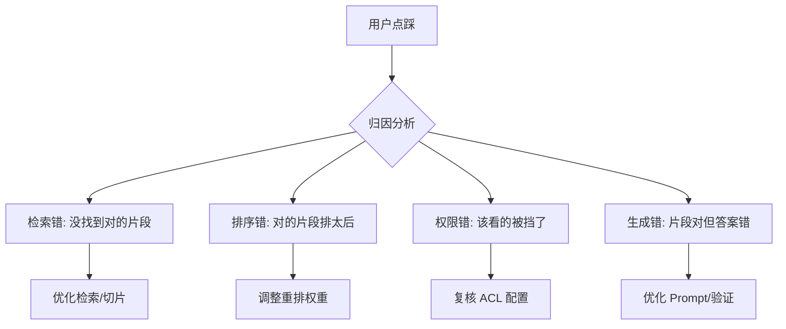
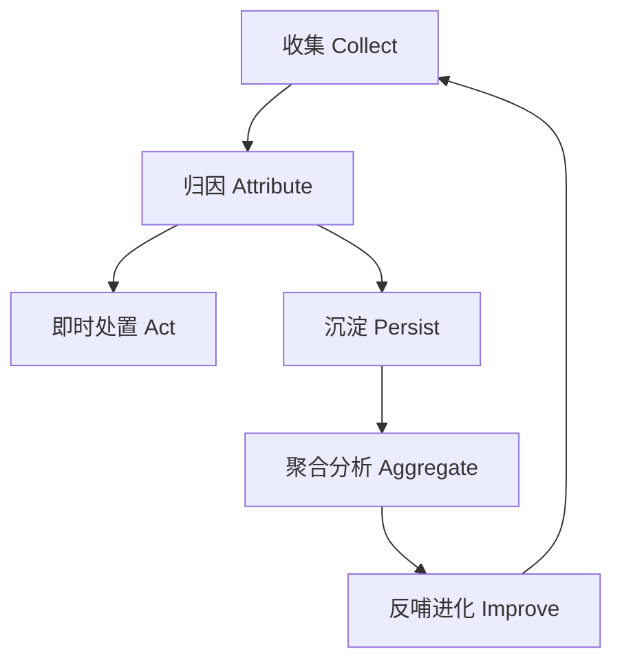

# Chapter 12 · Feedback 反馈闭环

> Ch11 把「我不知道」沉淀成了缺口资产。但知识库不能只靠运营手动补——真正让 Agent「越用越准」的飞轮，是把用户每一次「点赞 / 点踩 / 纠错」结构化收集、归因、并反哺回检索与知识库。本章讲怎么闭合这个环。

---

## 一、为什么学（Why）

### 1.1 没有反馈的 Agent 是「静态」的

前十一章，我们打造了一条严谨的推理链：路由 → 查询 → 检索 → 重排 → 权限 → 引用 → 验证 → 缺口治理。但它有一个致命特征——**上线那天多聪明，一年后还是那么聪明**。因为它没有从真实使用中学习的能力。

而真实世界里，用户天天在给你信号：

- 「这答案对，帮大忙了」（点赞）
- 「这答案不对」（点踩）
- 「应该是每天 800 不是 500」（纠错）
- 复制了答案就走 / 追问了三次还没解决（隐式信号）

**这些信号如果不收集，就是熵；收集并归因了，就是让系统进化的燃料。** 反馈闭环，就是把这股燃料引回系统的管道。

### 1.2 反馈的价值：三个层次的进化

| 层次 | 反馈驱动什么 | 例子 |
| --- | --- | --- |
| **即时** | 当前会话补救 | 点踩后立即触发二次检索 / 转人工 |
| **中期** | 检索与排序调优 | 高频点踩的 query→chunk 对，降低其排序权重 |
| **长期** | 知识库内容进化 | 纠错内容审核后写回知识库；高频缺口补文档|

一个成熟系统三个层次都要有。本章聚焦**如何结构化收集与归因**，为这三层进化打好数据地基。

### 1.3 本章要解决的三个命题

1. **收集什么**：显式反馈（赞/踩/纠错）与隐式反馈（行为信号）如何统一建模？
2. **怎么归因**：一次点踩，到底是检索错、排序错、还是生成错？怎么定位到链路的哪一环？
3. **怎么闭环**：反馈收集后，如何驱动即时补救 + 沉淀待优化项，形成飞轮？

---

## 二、是什么（What）

### 2.1 核心概念：显式反馈 vs 隐式反馈

| 维度 | 显式反馈 | 隐式反馈 |
| --- | --- | --- |
| 来源 | 用户主动操作 | 系统观测行为 |
| 例子 | 点赞、点踩、纠错、评分 | 复制答案、停留时长、追问次数、放弃会话 |
| 信噪比 | 高（但量少） | 低（但量大） |
| 用法 | 直接归因、可写回 | 聚合后作趋势信号 |

**关键设计**：两者统一到一个 `Feedback` 模型，用类型字段区分。显式反馈精准但稀疏，隐式反馈嘈杂但丰富，二者互补——只看显式会漏掉「大多数不满意的人只是默默离开」的沉默大多数。

### 2.2 归因：一次点踩到底错在哪

反馈闭环最难也最有价值的一步是**归因（Attribution）**——把「答案不好」这个笼统信号，定位到推理链的具体环节：



**归因靠什么？** 靠前面每一章埋下的**结构化痕迹**：`traceId` 串起全链路，`Citation` 记录了用哪些片段，`VerificationReport` 记录了验证结论。有了这些，归因才不是拍脑袋，而是有据可查。这也再次印证了前面章节「一切留痕、可追溯」设计的价值。

### 2.3 反馈的生命周期



**设计原则**：收集、归因、处置分离。`FeedbackCollector` 只管接收与校验；归因交给 `FeedbackAttributor`；处置（即时补救 / 落库）交给上层编排——单一职责，各自可替换、可测试。

---

## 三、怎么用（How）

> 代码位于包 `com.zero.ai.agentstudy.day16knowledgeagentv2.feedback`，复用 core 的 `AgentContext` / `AgentException` / `AgentErrorCode`，可独立编译。

### 3.1 反馈类型与归因结果枚举

```java
package com.zero.ai.agentstudy.day16knowledgeagentv2.feedback;

/**
 * 反馈信号类型：统一显式与隐式反馈。
 */
public enum FeedbackType {
    /** 显式点赞。 */
    THUMBS_UP(true),
    /** 显式点踩。 */
    THUMBS_DOWN(true),
    /** 显式纠错（附正确内容）。 */
    CORRECTION(true),
    /** 隐式：复制了答案（正向信号）。 */
    COPIED(false),
    /** 隐式：未解决即放弃会话（负向信号）。 */
    ABANDONED(false);

    private final boolean explicit;

    FeedbackType(boolean explicit) {
        this.explicit = explicit;
    }

    /** 是否为用户主动操作的显式反馈。 */
    public boolean isExplicit() {
        return explicit;
    }

    /** 是否为负向信号（用于快速筛选待优化项）。 */
    public boolean isNegative() {
        return this == THUMBS_DOWN || this == ABANDONED;
    }
}
```

```java
package com.zero.ai.agentstudy.day16knowledgeagentv2.feedback;

/**
 * 归因结论：把「答案不好」定位到推理链的具体环节。
 */
public enum AttributionResult {
    /** 检索环节问题：没找到该找到的片段。 */
    RETRIEVAL_MISS("检索未命中相关内容", "优化切片 / 补充文档"),
    /** 排序环节问题：对的片段排得太靠后。 */
    RANKING_ERROR("相关片段排序过低", "调整重排权重"),
    /** 权限环节问题：该看的被 ACL 挡了。 */
    ACCESS_ERROR("相关内容被权限拦截", "复核 ACL 标签配置"),
    /** 生成环节问题：片段正确但答案写错。 */
    GENERATION_ERROR("片段正确但答案有误", "优化 Prompt / 加强验证"),
    /** 无法定位或正向反馈。 */
    NONE("无需归因", "无");

    private final String reason;
    private final String suggestedAction;

    AttributionResult(String reason, String suggestedAction) {
        this.reason = reason;
        this.suggestedAction = suggestedAction;
    }

    public String reason() {
        return reason;
    }

    public String suggestedAction() {
        return suggestedAction;
    }
}
```

### 3.2 反馈记录：Feedback

```java
package com.zero.ai.agentstudy.day16knowledgeagentv2.feedback;

import com.zero.ai.agentstudy.day16knowledgeagentv2.core.common.AgentException;

import java.io.Serializable;
import java.time.Instant;

/**
 * 一条结构化反馈记录。traceId 是归因的关键锚点——串起当次回答的全链路痕迹。
 *
 * @param traceId    被反馈的那次回答的链路 ID
 * @param query      原始问题
 * @param type       反馈类型
 * @param comment    用户补充（纠错内容 / 吐槽），可空
 * @param createdAt  反馈时间
 */
public record Feedback(
        String traceId,
        String query,
        FeedbackType type,
        String comment,
        Instant createdAt
) implements Serializable {

    public Feedback {
        AgentException.requireText(traceId, "traceId");
        AgentException.requireText(query, "query");
        AgentException.requireNonNull(type, "type");
        comment = (comment == null) ? "" : comment;
        createdAt = (createdAt == null) ? Instant.now() : createdAt;
    }

    /** 便捷工厂。 */
    public static Feedback of(String traceId, String query, FeedbackType type, String comment) {
        return new Feedback(traceId, query, type, comment, Instant.now());
    }
}
```

### 3.3 归因所需的链路快照：AnswerTrace

归因需要「当次回答用了哪些片段、验证结论如何」。这些痕迹在生成答案时留存，归因时按 `traceId` 取回：

```java
package com.zero.ai.agentstudy.day16knowledgeagentv2.feedback;

import com.zero.ai.agentstudy.day16knowledgeagentv2.core.common.AgentException;

/**
 * 一次回答的链路快照（简化版），供反馈归因使用。
 *
 * @param traceId       链路 ID
 * @param topScore      当次检索最高相关度
 * @param citationCount 答案引用的片段数
 * @param verified      答案是否通过验证（Ch10）
 * @param aclFiltered   是否发生过 ACL 过滤（有内容被权限挡掉）
 */
public record AnswerTrace(
        String traceId,
        double topScore,
        int citationCount,
        boolean verified,
        boolean aclFiltered
) {
    public AnswerTrace {
        AgentException.requireText(traceId, "traceId");
    }
}
```

### 3.4 归因实现：RuleBasedFeedbackAttributor

对负向反馈，按链路快照的痕迹**优先级归因**——从最可能的根因开始判定：

```java
package com.zero.ai.agentstudy.day16knowledgeagentv2.feedback;

import com.zero.ai.agentstudy.day16knowledgeagentv2.core.common.AgentException;

/**
 * 基于规则的归因器：读链路快照，把负向反馈定位到具体环节。
 *
 * <p>归因优先级：检索命中弱 → 权限拦截 → 引用少（排序/生成）→ 验证未过。
 */
public final class RuleBasedFeedbackAttributor {

    private final double weakScoreThreshold;

    public RuleBasedFeedbackAttributor(double weakScoreThreshold) {
        AgentException.requireState(weakScoreThreshold >= 0 && weakScoreThreshold <= 1,
                "weakScoreThreshold 必须在 [0,1]");
        this.weakScoreThreshold = weakScoreThreshold;
    }

    /**
     * @param feedback 反馈记录
     * @param trace    对应的链路快照
     * @return 归因结论
     */
    public AttributionResult attribute(Feedback feedback, AnswerTrace trace) {
        AgentException.requireNonNull(feedback, "feedback");
        AgentException.requireNonNull(trace, "trace");

        // 正向 / 非负向反馈无需归因
        if (!feedback.type().isNegative() && feedback.type() != FeedbackType.CORRECTION) {
            return AttributionResult.NONE;
        }

        // 1. 检索本身就弱：最高分低于阈值 ⇒ 检索未命中
        if (trace.topScore() < weakScoreThreshold) {
            return AttributionResult.RETRIEVAL_MISS;
        }

        // 2. 发生过权限过滤且没引用到东西 ⇒ 可能被权限挡了
        if (trace.aclFiltered() && trace.citationCount() == 0) {
            return AttributionResult.ACCESS_ERROR;
        }

        // 3. 检索分不低但引用很少 ⇒ 对的片段没被排上来（排序问题）
        if (trace.citationCount() == 0) {
            return AttributionResult.RANKING_ERROR;
        }

        // 4. 有引用、检索也不弱，但验证没过或用户纠错 ⇒ 生成环节写错
        if (!trace.verified() || feedback.type() == FeedbackType.CORRECTION) {
            return AttributionResult.GENERATION_ERROR;
        }

        // 引用充足、验证也过，却仍被点踩：暂无法自动归因
        return AttributionResult.NONE;
    }
}
```

### 3.5 端到端演示：Chapter12Demo

```java
package com.zero.ai.agentstudy.day16knowledgeagentv2.feedback;

public class Chapter12Demo {

    public static void main(String[] args) {
        var attributor = new RuleBasedFeedbackAttributor(0.5);
        String q = "2026 年差旅报销标准是多少？";

        // 场景一：检索最高分只有 0.3 ⇒ 检索未命中
        demo("检索弱", attributor,
                Feedback.of("t1", q, FeedbackType.THUMBS_DOWN, ""),
                new AnswerTrace("t1", 0.30, 0, false, false));

        // 场景二：检索分高但发生权限过滤且无引用 ⇒ 权限拦截
        demo("权限挡", attributor,
                Feedback.of("t2", q, FeedbackType.THUMBS_DOWN, ""),
                new AnswerTrace("t2", 0.80, 0, false, true));

        // 场景三：检索分高、无引用、无过滤 ⇒ 排序问题
        demo("排序偏", attributor,
                Feedback.of("t3", q, FeedbackType.THUMBS_DOWN, ""),
                new AnswerTrace("t3", 0.85, 0, false, false));

        // 场景四：用户纠错「应为 800」，有引用但生成写错 ⇒ 生成错误
        demo("纠错", attributor,
                Feedback.of("t4", q, FeedbackType.CORRECTION, "应为每天 800 元"),
                new AnswerTrace("t4", 0.90, 2, true, false));

        // 场景五：点赞 ⇒ 无需归因
        demo("点赞", attributor,
                Feedback.of("t5", q, FeedbackType.THUMBS_UP, ""),
                new AnswerTrace("t5", 0.90, 2, true, false));
    }

    private static void demo(String scene, RuleBasedFeedbackAttributor attr,
                             Feedback fb, AnswerTrace trace) {
        AttributionResult r = attr.attribute(fb, trace);
        System.out.printf("[%s] 反馈=%s 归因=%s | 原因=%s | 建议=%s%n",
                scene, fb.type(), r, r.reason(), r.suggestedAction());
    }
}
```

**运行输出示意**：

```
[检索弱] 反馈=THUMBS_DOWN 归因=RETRIEVAL_MISS | 原因=检索未命中相关内容 | 建议=优化切片 / 补充文档
[权限挡] 反馈=THUMBS_DOWN 归因=ACCESS_ERROR | 原因=相关内容被权限拦截 | 建议=复核 ACL 标签配置
[排序偏] 反馈=THUMBS_DOWN 归因=RANKING_ERROR | 原因=相关片段排序过低 | 建议=调整重排权重
[纠错] 反馈=CORRECTION 归因=GENERATION_ERROR | 原因=片段正确但答案有误 | 建议=优化 Prompt / 加强验证
[点赞] 反馈=THUMBS_UP 归因=NONE | 原因=无需归因 | 建议=无
```

同样是「点踩」，归因器结合链路快照给出了**完全不同的根因与优化建议**——这就是结构化痕迹 + 规则归因的威力：让「答案不好」从模糊抱怨变成可执行的工单。

---

## 四、真实项目落地

1. **反馈异步落库，绝不阻塞主链路**：`FeedbackCollector` 收到反馈后发领域事件，异步写 `feedback` 表（traceId、tenantId、type、attribution、comment）。用户点个踩不该卡住界面。

2. **归因器逐步升级**：本章规则版是起点。生产可演进为：规则兜底 + 轻量模型分类（用历史「反馈+链路+人工标注根因」训练），再到 LLM-as-Judge 复核疑难 case。端口不变，实现替换。

3. **纠错内容必须审核后才写回**：`CORRECTION` 反馈是最珍贵的信号，但**绝不能直接写回知识库**——否则一次恶意纠错就污染了全租户。必须进人工/管理员审核队列，通过后才更新，并触发相关缓存与缺口复检。

4. **聚合出「优化工单」**：定时按 `(attribution, 归一化 query)` 聚合负向反馈，产出优先级排序的优化清单：RETRIEVAL_MISS 高频 → 推给内容团队；RANKING_ERROR 高频 → 推给算法团队。让反馈直接驱动迭代排期。

5. **隐式信号谨慎解读**：`ABANDONED`（放弃会话）不等于答案差——用户可能只是被叫去开会。隐式信号只作**聚合趋势**参考，绝不单条归因或直接写回，避免误伤。

---

## 五、避坑与优化

| 坑 | 后果 | 正解 |
| --- | --- | ---|
| 反馈同步写库阻塞主链路 | 界面卡顿、体验劣化 | 事件驱动异步落库 |
| 纠错内容直接写回知识库 | 一次恶意纠错污染全租户 | 强制人工审核后才写回 |
| 只收显式反馈 | 漏掉沉默的不满意大多数 | 显式 + 隐式统一建模 |
| 点踩不归因、只计数 | 知道「有问题」但不知「改哪」 | 结合链路快照定位到环节 |
| 隐式信号单条归因 | 误伤（放弃≠答案差） | 隐式只作聚合趋势 |
| 反馈落库后无人看 | 数据成坟墓、飞轮转不起来 | 聚合成优化工单驱动迭代 |

**一句话总结**：反馈闭环把 Agent 从「静态的知识查询器」升级为「越用越准的学习系统」——而这一切的地基，是前面每一章埋下的 `traceId` 与结构化痕迹。收集、归因、闭环，三步缺一不可。

---

> **下一章预告 · Chapter 13 · Evaluation 离线评估**：反馈是线上的、被动的信号。但上线前怎么知道系统好不好？改了一版 Prompt / 换了重排模型，怎么量化证明它更强了？下一章讲如何用评估集 + 指标（命中率、忠实度、答案相关性）做离线评估，让每次迭代有据可依。