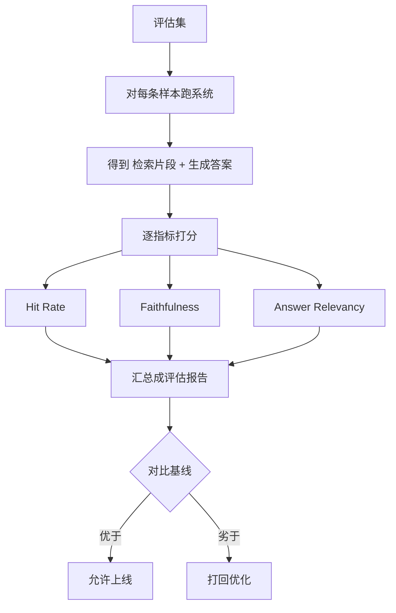

# Chapter 13 · Evaluation 离线评估

> Ch12 的反馈是**线上、被动、滞后**的信号——用户点踩了你才知道错了。但一次上线可能已经伤了成百上千用户。本章讲怎么在上线**之前**，用评估集 + 量化指标证明「新版本确实比旧版本更强」，让每次迭代有据可依，而不是拍脑袋。

---

## 一、为什么学（Why）

### 1.1 「我觉得变好了」不是工程

你换了个重排模型、改了版 Prompt、调了检索的 topK。上线后同事问：「效果提升了多少？」你答：「感觉挺好的，我试了几个问题都对。」

这在企业级系统里是**不可接受**的：

- **样本偏差**：你试的那几个问题，恰好是你熟悉的、容易的。
- **无法回归**：改 A 修好了，会不会悄悄弄坏了 B？靠手测根本覆盖不到。
- **无法比较**：新旧两版到底哪个好？好多少？没有数字就没有结论。
- **无法止损**：上线后靠用户点踩发现问题，代价是真实用户的信任。

**离线评估（Offline Evaluation）就是把「我觉得」变成「数据证明」**：用一个固定的评估集，跑出可复现、可比较的指标，让每次改动的效果**上线前就能量化**。

### 1.2 离线评估 vs 线上反馈

| 维度 | 离线评估（本章） | 线上反馈（Ch12） |
| --- | --- | --- |
| 时机 | 上线前 | 上线后 |
| 数据 | 固定评估集（有标准答案） | 真实用户流量 |
| 作用 | 回归、选型、止损 | 持续进化、发现盲区 |
| 特点 | 可复现、可比较 | 真实、但滞后 |

两者互补：离线评估是**上线前的守门员**，线上反馈是**上线后的探测器**。而且线上高频点踩的 case，正好可以补充进离线评估集——闭环再次形成。

### 1.3 本章要解决的三个命题

1. **评估集怎么建**：一条评估样本包含什么？标准答案从哪来？
2. **指标怎么选**：RAG 系统该量化哪几个维度？各自衡量什么？
3. **怎么跑评估**：如何用一套评估器对系统跑分，并支持新旧版本对比？

---

## 二、是什么（What）

### 2.1 核心概念：评估集（Evaluation Dataset）

评估集是一组**带标准答案的测试样本**。每条样本至少包含：

| 字段 | 含义 | 例子 |
| --- | --- | --- |
| query | 用户问题 | 「全职员工年假多少天？」|
| expectedAnswer | 标准答案（Ground Truth） | 「15 天」 |
| relevantChunkIds | 应被检索到的关键片段 ID | [c-hr-007] |

**评估集从哪来？** 三个渠道：① 业务专家手工标注核心问题；② 从线上真实日志采样（尤其是 Ch12 高频点踩的）；③ 用 LLM 辅助生成候选，再人工审核。质量 > 数量——100 条高质量样本远胜 1 万条噪声。

### 2.2 核心指标：衡量 RAG 系统的三个维度

RAG 系统的质量拆成两段：**检索得准不准** + **生成得对不对**。对应三个核心指标：

| 指标 | 衡量什么 | 属于 | 通俗理解 |
| --- | --- | --- | --- |
| **Hit Rate（命中率）** | 相关片段有没有被检索到 | 检索 | 「该找的资料找到了吗」 |
| **Faithfulness（忠实度）** | 答案是否忠于检索片段 | 生成 | 「答案有没有瞎编」 |
| **Answer Relevancy（答案相关性）** | 答案是否切题、贴近标准答案 | 生成 | 「答的是不是用户问的」 |

**为什么要拆开？** 因为定位问题需要分层：如果命中率高但忠实度低 → 检索没问题，是生成在幻觉；如果命中率就低 → 病根在检索，优化生成是白费力气。这与 Ch12 的归因思路一脉相承——**先分层，再对症**。

### 2.3 评估的整体流程



**设计原则**：每个指标是一个可插拔的 `Metric` 端口，评估器只负责编排与汇总。演示版用简单规则打分，生产可无缝替换为 LLM-as-Judge 或专用评估模型（如 RAGAS）。

---

## 三、怎么用（How）

> 代码位于包 `com.zero.ai.agentstudy.day16knowledgeagentv2.eval`，复用 core 的 `AgentException`，可独立编译。

### 3.1 评估样本与系统输出

```java
package com.zero.ai.agentstudy.day16knowledgeagentv2.eval;

import com.zero.ai.agentstudy.day16knowledgeagentv2.core.common.AgentException;

import java.util.List;

/**
 * 一条评估样本：问题 + 标准答案 + 应命中的关键片段。
 */
public record EvalSample(
        String query,
        String expectedAnswer,
        List<String> relevantChunkIds
) {
    public EvalSample {
        AgentException.requireText(query, "query");
        AgentException.requireText(expectedAnswer, "expectedAnswer");
        relevantChunkIds = (relevantChunkIds == null) ? List.of() : List.copyOf(relevantChunkIds);
    }
}
```

```java
package com.zero.ai.agentstudy.day16knowledgeagentv2.eval;

import com.zero.ai.agentstudy.day16knowledgeagentv2.core.common.AgentException;

import java.util.List;

/**
 * 系统对一条样本的实际输出：检索到的片段 ID + 生成的答案。
 */
public record SystemOutput(
        List<String> retrievedChunkIds,
        String answer
) {
    public SystemOutput {
        retrievedChunkIds = (retrievedChunkIds == null) ? List.of() : List.copyOf(retrievedChunkIds);
        answer = (answer == null) ? "" : answer;
    }
}
```

### 3.2 指标端口与评分结果

```java
package com.zero.ai.agentstudy.day16knowledgeagentv2.eval;

/**
 * 单指标评分结果。
 *
 * @param name  指标名
 * @param score 得分 [0,1]
 */
public record MetricScore(String name, double score) {
    public MetricScore {
        if (score < 0 || score > 1) {
            throw new IllegalArgumentException("score 必须在 [0,1]：" + score);
        }
    }
}
```

```java
package com.zero.ai.agentstudy.day16knowledgeagentv2.eval;

/**
 * 评估指标端口：对单条样本的系统输出打分。
 *
 * <p>可插拔：演示版用规则，生产可替换为 LLM-as-Judge / RAGAS。
 */
public interface Metric {

    /** 指标名。 */
    String name();

    /** 对一条样本的输出打分，返回 [0,1]。 */
    double score(EvalSample sample, SystemOutput output);
}
```

### 3.3 三个核心指标的演示实现

```java
package com.zero.ai.agentstudy.day16knowledgeagentv2.eval;

import java.util.HashSet;
import java.util.Set;

/**
 * 命中率：相关片段被检索到的比例（属于检索质量）。
 */
public final class HitRateMetric implements Metric {

    @Override
    public String name() {
        return "HitRate";
    }

    @Override
    public double score(EvalSample sample, SystemOutput output) {
        var relevant = sample.relevantChunkIds();
        if (relevant.isEmpty()) {
            return 1.0; // 无相关性要求，视为满分
        }
        Set<String> retrieved = new HashSet<>(output.retrievedChunkIds());
        long hit = relevant.stream().filter(retrieved::contains).count();
        return (double) hit / relevant.size();
    }
}
```

```java
package com.zero.ai.agentstudy.day16knowledgeagentv2.eval;

/**
 * 答案相关性：生成答案与标准答案的贴近程度（演示用字符重叠）。
 *
 * <p>生产应替换为语义相似度（embedding 余弦）或 LLM-as-Judge。
 */
public final class AnswerRelevancyMetric implements Metric {

    @Override
    public String name() {
        return "AnswerRelevancy";
    }

    @Override
    public double score(EvalSample sample, SystemOutput output) {
        return overlapRatio(sample.expectedAnswer(), output.answer());
    }

    /** 期望答案的字符集合被实际答案覆盖的比例。 */
    static double overlapRatio(String expected, String actual) {
        if (expected == null || expected.isBlank()) {
            return 0.0;
        }
        java.util.Set<Character> exp = expected.chars()
                .filter(c -> !Character.isWhitespace(c))
                .mapToObj(c -> (char) c)
                .collect(java.util.stream.Collectors.toSet());
        if (exp.isEmpty()) {
            return 0.0;
        }
        java.util.Set<Character> act = (actual == null ? "" : actual).chars()
                .mapToObj(c -> (char) c)
                .collect(java.util.stream.Collectors.toSet());
        long hit = exp.stream().filter(act::contains).count();
        return (double) hit / exp.size();
    }
}
```

`Faithfulness`（忠实度）本质是 Ch10 验证的复用——答案是否能被检索片段支持，可直接接入 `AnswerVerifier` 的置信度作为得分，此处不再重复实现。

### 3.4 评估器：Evaluator 与评估报告

```java
package com.zero.ai.agentstudy.day16knowledgeagentv2.eval;

import com.zero.ai.agentstudy.day16knowledgeagentv2.core.common.AgentException;

import java.util.*;
import java.util.function.Function;

/**
 * 评估器：对整个评估集逐样本、逐指标打分，汇总成报告。
 */
public final class Evaluator {

    private final List<Metric> metrics;

    public Evaluator(List<Metric> metrics) {
        AgentException.requireNonNull(metrics, "metrics");
        AgentException.requireState(!metrics.isEmpty(), "至少需要一个指标");
        this.metrics = List.copyOf(metrics);
    }

    /**
     * @param dataset 评估集
     * @param system  被评估系统：给定样本产出系统输出
     * @return 各指标的平均分
     */
    public Map<String, Double> evaluate(List<EvalSample> dataset,
                                        Function<EvalSample, SystemOutput> system) {
        AgentException.requireNonNull(dataset, "dataset");
        AgentException.requireState(!dataset.isEmpty(), "评估集不能为空");

        Map<String, Double> sum = new LinkedHashMap<>();
        for (Metric m : metrics) {
            sum.put(m.name(), 0.0);
        }
        for (EvalSample sample : dataset) {
            SystemOutput out = system.apply(sample);
            for (Metric m : metrics) {
                sum.merge(m.name(), m.score(sample, out), Double::sum);
            }
        }
        Map<String, Double> avg = new LinkedHashMap<>();
        int n = dataset.size();
        sum.forEach((k, v) -> avg.put(k, v / n));
        return avg;
    }
}
```

### 3.5 端到端演示：Chapter13Demo

```java
package com.zero.ai.agentstudy.day16knowledgeagentv2.eval;

import java.util.List;
import java.util.Map;

public class Chapter13Demo {

    public static void main(String[] args) {
        // 1. 构建评估集
        var dataset = List.of(
                new EvalSample("全职员工年假多少天？", "15 天", List.of("c-hr-007")),
                new EvalSample("试用期多久？", "6 个月", List.of("c-hr-012")));

        var evaluator = new Evaluator(List.of(
               new HitRateMetric(), new AnswerRelevancyMetric()));

        // 2. 基线版本：检索命中、答案正确
        Map<String, Double> base = evaluator.evaluate(dataset, s ->
                switch (s.query()) {
                    case "全职员工年假多少天？" -> new SystemOutput(List.of("c-hr-007"), "15 天");
                    default -> new SystemOutput(List.of("c-hr-012"), "6 个月");
                });
        System.out.println("[基线版] " + base);

        // 3. 新版本：年假题检索漏了、答案还写错成 20 天
        Map<String, Double> candidate = evaluator.evaluate(dataset, s ->
                switch (s.query()) {
                    case "全职员工年假多少天？" -> new SystemOutput(List.of("c-hr-999"), "20 天");
                    default -> new SystemOutput(List.of("c-hr-012"), "6 个月");
                });
        System.out.println("[新版本] " + candidate);

        // 4. 对比裁决
        boolean better = candidate.get("HitRate") >= base.get("HitRate")
                && candidate.get("AnswerRelevancy") >= base.get("AnswerRelevancy");
        System.out.println(better ? "✅ 新版本不劣于基线，允许上线" : "❌ 新版本出现回退，打回优化");
    }
}
```

**运行输出示意**：

```
[基线版] {HitRate=1.0, AnswerRelevancy=1.0}
[新版本] {HitRate=0.5, AnswerRelevancy=0.75}
❌ 新版本出现回退，打回优化
```

新版本的年假题**检索漏了、答案也写错**，命中率从 1.0 掉到 0.5、相关性从 1.0掉到 0.75——**在上线前就被评估拦下**，而不是等真实用户点踩。这就是离线评估作为「守门员」的价值。

---

## 四、真实项目落地

1. **评估跑进 CI 门禁**：把评估作为 CI 的一道 gate——每次改检索/重排/Prompt 的 PR，自动跑评估集，指标低于基线阈值则**阻断合并**。让「不许回退」成为强制约束，而非口头承诺。

2. **指标实现逐步升级**：本章的字符重叠是演示。生产按顺序升级：Answer Relevancy → embedding 余弦相似度 → LLM-as-Judge；Faithfulness → 直接复用 Ch10 的 NLI 验证器。端口 `Metric` 不变，实现替换。

3. **分层看指标，别只看总分**：一个总分掩盖不了结构性问题。永远拆开看：命中率降了是检索的锅，忠实度降了是生成的锅。这让优化**有的放矢**（呼应 Ch12 归因）。

4. **评估集要持续养护**：线上 Ch12 高频点踩的 case、新上线的业务场景，都要定期补进评估集。评估集覆盖不到的地方，就是评估的盲区。同时警惕「过拟合评估集」——只对着评估集调参，可能损害泛化。

5. **成本与采样**：LLM-as-Judge 评估有 token 成本。大评估集可分层——核心子集每次 PR 跑，全量集每日/每周跑。平衡成本与覆盖。

---

## 五、避坑与优化

| 坑 | 后果 | 正解 |
| --- | --- | ---|
| 靠手测几个问题下结论 | 样本偏差、无法回归 | 固定评估集 + 量化指标 |
| 只看一个总分 | 掩盖结构性回退 | 检索/生成指标分层看 |
| 字符重叠冒充语义评估 | 换个说法就误判 | 升级 embedding / LLM-as-Judge |
| 评估集一成不变 | 覆盖不到新场景与盲区 | 持续补充线上点踩 case |
| 只对着评估集调参 | 过拟合、损害泛化 | 留出 holdout 集、监控线上 |
| 评估不进 CI | 全靠自觉、迟早回退 | 评估作 CI 门禁强制拦截 |

**一句话总结**：离线评估把「我觉得变好了」变成「数据证明变好了」——用带标准答案的评估集、分层的量化指标、进 CI 的强制门禁，让每次迭代都有据可依、绝不回退。

---

> **下一章预告 · Chapter 14 · Observability 可观测性**：评估是「批量、离线」看质量，但线上系统实时跑着——某次请求慢在哪一环？错误率突增是哪个租户？下一章讲用 Trace / Metrics / Log 三支柱，让整条推理链在生产环境「看得见、查得到、报得警」。